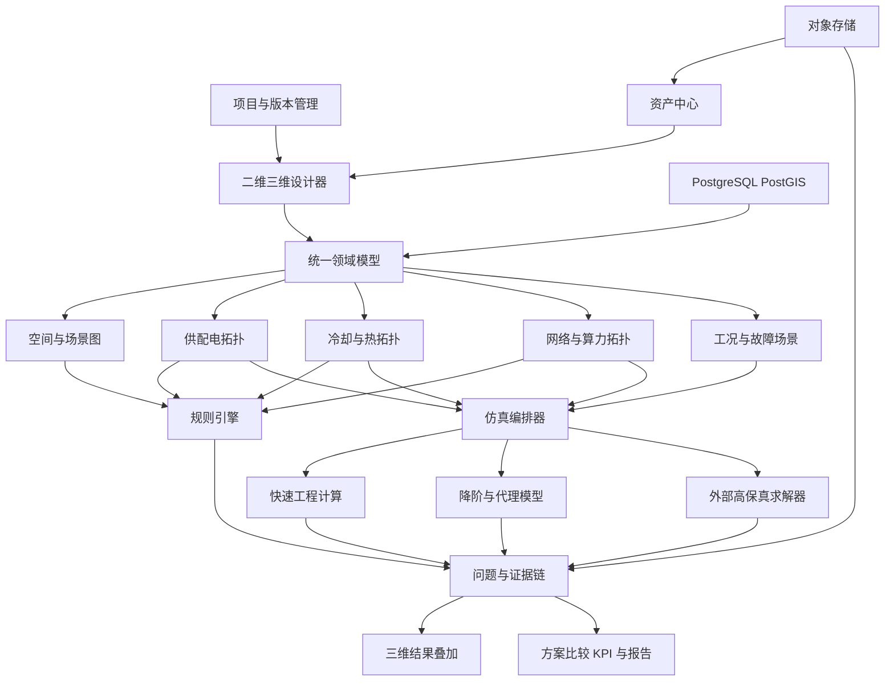

# 算电协同数字孪生平台一期总体设计 v0.1

编制日期 2026 年 9 月 23 日

设计依据包括用户提供的《NVIDIA Omniverse DSX Blueprint 中文译本》、NVIDIA 当前公开的 DSX 官方资料，以及 OpenUSD、IFC、Redfish 的官方规范。本文把附件中的事实、公开资料中的事实和本方案的工程判断分开表述。

## 一 结论与能力边界

这个平台可以做，而且适合先从设计期数字孪生切入。

依靠当前的软件工程和智能编码能力，可以完成产品设计、交互原型、三维编辑器、资产与连接模型、规则引擎、快速仿真、求解器编排、版本比较、报告、测试和部署。要把它做成能够影响真实工程决策的生产平台，还需要数据中心电气、暖通、液冷、网络工程师参与规则确认和模型标定，也需要设备厂商参数、真实样板机房数据以及必要的专业求解器。

因此，项目的合理目标分为三层。

| 层次 | 可交付结果 | 主要条件 |
| --- | --- | --- |
| 概念原型 | 可拖拽搭建机房，能展示电、冷、网连接和基本风险 | 参数化简模与少量示例数据 |
| 可试用 MVP | 能做容量校核、故障传播、快速热风险判断和方案比较 | 真实样板机房、规则清单、工程计算基准 |
| 生产平台 | 能接专业求解器、BIM、设备遥测和运行系统，结果可审计 | 多专业团队、数据治理、模型校准、持续验证 |

一期应定位为面向数据中心设计人员的设计期数字孪生与工程校核工作台。它暂不接管现场控制，也不承担注册工程师的签章责任。

## 二 从 NVIDIA 附件中应该吸收什么

附件最有价值的部分有四项。

1. 用 OpenUSD 组织大型三维场景和资产装配。
2. 用 SimReady 思路给设备补齐电气、热工、冷却和连接点语义。
3. 把网络、电力、热和场地求解器接到同一个数字孪生运行时。
4. 用代理模型提供秒级假设分析，再用高保真求解器完成深入验证。

附件也明确暴露了生产化之前的缺口。

- 蓝图面向开发者，属于集成示例，不能直接视为生产应用。
- 多项 KPI 和成本值来自前端硬编码。
- 热仿真、电气仿真和分析 KPI 尚未形成统一计算链路。
- 三维串流需要较高的 GPU 和部署成本。

这决定了我们的优先级。三维拖拽要尽早可用，真正的核心仍然是设备语义、连接拓扑、规则、计算模型、版本和证据链。

NVIDIA 当前公开的 DSX 体系已经扩展到 DSX Sim、DSX OS、DSX MaxLPS、DSX Exchange、DSX Flex 和参考设计。它覆盖设计仿真、运行软件、固定功率包络内的性能优化、IT 与 OT 数据交换，以及电网信号驱动的灵活用电。这个方向适合作为长期路线，一期只取其中的设计仿真部分。

## 三 一期必须回答的五个问题

平台应基于一个真实样板机房，可复现地回答以下问题。

1. 给定空间、供电和冷却条件，最多能部署多少算力柜和 GPU。
2. 当前限制来自空间、承重、供电、制冷还是网络。
3. UPS、RPP、CDU、泵或链路发生单点故障后，还能保留多少算力。
4. 哪个设备、端口或连接违反了哪条规则，输入值和阈值分别是多少。
5. 两个设计方案哪个更合理，差异来自容量、可靠性、成本、能效还是实施风险。

当平台能够稳定回答这五个问题时，三维模型才真正进入工程工作流。

## 四 一期范围

建议选取一个 2 至 5 MW、50 至 100 柜的液冷 AI 数据机房作为金样板。

### 一期包含

- 单机房空间建模和轻量 BIM 导入。
- 墙、门、柱、通道、禁入区、承重区和冷热通道。
- GPU 柜、通用服务器柜、交换机、UPS、PDU、RPP、母线、机柜 PDU、CDU、CRAH、泵和歧管等资产。
- 二维平面与三维场景同源编辑。
- 电力、冷却、网络和算力四类关系。
- 碰撞、间距、承重、U 位、容量、端口兼容和冗余校核。
- 稳态容量计算、单点故障传播和快速热风险估算。
- 设计版本、场景、方案比较、BOM、问题清单和设计报告。
- 所有输入、假设、规则、求解器和结果的数据血缘。

### 一期暂缓

- 完整园区、变电站和公用电网仿真。
- 实时接入 BMS、DCIM、EMS、SCADA 和现场控制。
- 自研完整 CFD、短路计算、谐波分析和保护配合。
- 电力市场交易、跨园区调度和自动控制。
- 采购、工单、计费和资产运维全流程。
- 以聊天智能体代替专业工作台。

## 五 产品工作流程

```text
新建或导入机房
        ↓
拖拽和参数化布置设备
        ↓
连接电力 冷却 网络与算力关系
        ↓
即时规则校核和容量提示
        ↓
运行正常工况与故障场景
        ↓
三维着色 拓扑定位 问题解释
        ↓
保存版本并比较方案
        ↓
导出 BOM 问题清单与设计报告
```

## 六 总体架构



### 关键设计原则

1. 几何场景、资产语义、领域拓扑和工况场景分开保存，通过稳定 ID 关联。
2. 三维文件承担交换、装配和显示职责，业务数据库承担权威主数据职责。
3. 每次计算都记录输入快照、规则版本、求解器版本、参数和结果哈希。
4. 即时预览可以在前端运行，权威校核必须在服务端重新执行。
5. 所有结果都标明可信度等级和适用范围。

OpenUSD 官方文档说明它擅长资产装配、分层覆盖、变体、延迟加载和大规模实例化，同时也明确 USD 本身不使用 GUID。由此产生一个直接设计决策。平台必须在业务数据库中维护稳定 UUID 和 IFC GUID，不能把 USD 路径当成长期业务主键。

## 七 统一领域模型

### 空间与场景模型

保存园区、建筑、楼层、机房、区域、排、机柜、U 位和设备的层级关系，以及坐标、旋转、包围盒、维护区、通道、承重区和可见性。

### 资产语义模型

| 对象 | 主要内容 |
| --- | --- |
| AssetTypeVersion | 类别、厂商、型号、几何、尺寸、重量、额定值、性能曲线、端口模板、规则集、来源、许可、版本 |
| AssetInstance | 型号版本、父级、位置、旋转、实例覆盖参数、设计状态 |
| Port | 所属领域、介质、方向、电压、容量、流量、温压、带宽、连接器、局部坐标和朝向 |
| Connection | 两端端口、路径、长度、容量、损耗、延迟、冗余组和状态 |
| SpaceZone | 房间或区域边界、高度、承重、禁入区、维护区和冷热通道属性 |
| Scenario | 基线版本、环境参数、负载覆盖、故障注入和工作负载优先级 |
| SimulationRun | 输入快照、求解器版本、结果位置、运行日志、可信度和输入哈希 |
| Finding | 规则 ID、严重度、受影响对象、当前值、阈值、证据、建议和豁免记录 |

全部内部计算统一使用 SI 单位。对外展示可以换算，原始单位和来源仍需保留。

### 领域拓扑

供配电链路可从市电、发电机、变压器、开关柜、UPS、PDU 或 RPP、母线、机柜 PDU 一直追踪到 IT 设备。

冷却链路可从冷源、泵、CDU 或 CRAH、歧管、机柜或芯片追踪供回路，端口要区分介质、方向、温度、压力和流量。

网络链路可从核心、Spine、Leaf 追踪到服务器，记录端口类型、速率、带宽、超卖比、路径和冗余。

算力关系记录 GPU 类型、数量、功率档位、利用率、工作负载类型、吞吐基准和优先级，并与电力、冷却和网络约束建立关联。

## 八 资产生产规范

设备拖入场景后必须同时成为可计算对象。建议采用以下资产流水线。

```text
厂商 CAD IFC 或参数表
        ↓
单位 轴向 原点和安装基准规范化
        ↓
几何清理 轻量化 实例化和多级细节
        ↓
几何验证
        ↓
添加通用属性和领域参数
        ↓
添加电 冷 风 网络连接点
        ↓
属性 连接点和规则验证
        ↓
发布不可变资产版本
```

浏览器运行时优先使用 GLB。IFC 用于 BIM 交换。OpenUSD 用于高阶场景装配、资产协作和对接 Omniverse。大型 CAD 不直接交给浏览器解析。

buildingSMART 当前把 IFC 4.3.2.0 列为 Official，IFC 4.4 和 IFC 5 仍处于开发状态。因此，一期把 IFC 4.3 作为目标交换版本较稳妥，同时兼容项目中常见的 IFC 2x3 和 IFC 4 输入。

## 九 拖拽编辑器必须具备的工程约束

- 网格、墙面、机柜 U 位和设备端口吸附。
- 拖动期间显示合法或非法放置预览。
- AABB、OBB 和 BVH 碰撞检测。
- 前后维修距离、门开启区、消防和运输通道检查。
- 机柜 U 位、重量、区域承重和成排布置检查。
- 冷热通道方向和送回风关系检查。
- 端口类型、方向、介质、电压、容量、流量和带宽兼容检查。
- 电缆、母线、管线和光纤路径长度估算。
- 撤销恢复、复制阵列、对齐分布、图层、测距和相机预设。
- 从三维对象跳转到电、冷、网拓扑，也能从拓扑定位三维对象。

## 十 仿真分层

| 等级 | 目标 | 典型时延 | 一期安排 |
| --- | --- | --- | --- |
| L0 | 几何、规则、U 位、端口和连接校核 | 毫秒至秒 | 完整实现 |
| L1 | 电力、冷量、流量、带宽和容量平衡 | 秒级 | 完整实现 |
| L2 | 区域热模型、故障传播和降阶模型 | 秒至分钟 | 实现核心场景 |
| L3 | CFD、潮流、短路、保护配合等专业求解 | 分钟至小时 | 做适配接口 |
| L4 | 遥测校准、预测和运行调度 | 持续运行 | 后续阶段 |

### 电力快速计算

一期计算稳态负载、容量、损耗、降额、相位平衡、UPS 续航估算、单设备或单支路故障、负载转移和 N 加 1 检查。短路、谐波和保护配合交给专业工具适配器。

### 冷却与热风险

一期采用机柜和区域级热平衡，输入 IT 热负荷、风量或液体流量、供回温度、液冷比例、CDU 或 CRAH 容量和环境条件，输出入口温度风险、热点等级、冷却余量和设计 PUE 估算。

未经真实机房校准的热结果只能标为概念设计级或趋势提示。高保真 CFD 通过异步任务接入，结果再映射回相同资产 ID。

### 网络计算

一期检查端口数量、带宽、超卖比、跳数、链路冗余、断链可达性、线缆长度和近似时延，不做包级仿真。

### 算电协同指标

一期优先提供以下指标。

- 当前条件下可部署 GPU 和算力柜数量。
- 正常工况下的可持续算力。
- N 加 1 故障后的保留 GPU 和保留算力。
- 电力、冷却、网络和空间余量。
- 电力上限变化时需要降载或迁移的工作负载。
- 方案间的设备数、IT 功率、设施功率、PUE、风险和成本差异。

每 token 能耗只有在 AI 模型、批量、精度、吞吐、硬件功率和统计周期都明确时才计算，不能使用固定演示值。

## 十一 规则引擎

规则不能散落在前端代码中。建议使用版本化声明式规则，服务端负责权威执行。

每条规则至少包含规则 ID、适用对象、参数、判断表达式、严重度、标准来源、版本、生效日期、修复建议和豁免流程。

一期优先整理 30 至 50 条高价值规则，覆盖以下类别。

- 空间碰撞与维护距离。
- 通道宽度、门和运输路径。
- 承重和机柜重量。
- U 位和设备安装约束。
- 电压与端口兼容。
- 回路、UPS、PDU、RPP 和母线容量。
- 关键负载双路供电与独立上游路径。
- CDU、CRAH、泵、歧管和支路容量。
- 供回路方向、介质、流量和温差。
- 网络端口、带宽和冗余。
- 孤立设备、缺失参数和未连接端口。

## 十二 关键页面

### 项目中心

管理项目、设计版本、校核状态、待处理问题和最近仿真。新建向导收集机房、供电、冷却和算力需求。

### 数字孪生设计器

左侧放资产库，中间放二维或三维场景，右侧放设备属性、端口和连接，底部放问题列表和任务进度。顶部管理版本、场景、撤销、保存和运行校核。

### 系统拓扑

自动生成供电单线关系、冷却网络和网络拓扑。选中设备后高亮完整上下游链路和故障影响范围。

### 设计校核中心

按阻断、错误、警告和建议分组。点击问题后定位对象，显示规则、当前值、阈值、证据和修改建议。

### 场景仿真实验室

选择基线版本，设置负载率、环境温度、电力上限、设备故障和工作负载优先级。结果同时显示在三维场景、拓扑、数值和问题列表中。

### 方案比较与报告

比较两个或多个版本的几何、设备、连接、容量、故障结果、成本和未解决风险，输出 PDF 和 Excel 报告。

### 资产中心

维护几何、参数、性能曲线、连接点、规则、来源和版本。新资产通过校验后才能发布。

## 十三 推荐技术路线

### 前端

- React 与 TypeScript。
- Three.js 或 react-three-fiber 负责三维编辑。
- React Flow 负责电、冷、网拓扑。
- Zustand 或 Redux Toolkit 管理编辑状态。
- GLB、Meshopt、GPU Instancing 和 LOD 控制场景性能。

### 后端

- FastAPI 与 Python，便于衔接几何、科学计算和求解器生态。
- PostgreSQL 与 PostGIS 保存主数据、版本、空间和拓扑。
- MinIO 或兼容 S3 的对象存储保存模型、结果和报告。
- Redis 与异步任务队列运行仿真和转换任务。
- 模块化单体起步，仿真 Worker 独立容器化。

### 部署

- 开发和早期试点使用 Docker Compose。
- 多用户和弹性仿真进入试点后再使用 Kubernetes。
- 接入 OIDC、RBAC、租户隔离、审计日志和签名下载地址。

### 与 Omniverse 的关系

一期编辑器采用 Web 原生路线，减少每个会话占用 GPU 和 WebRTC 串流的成本，同时保留 OpenUSD 导入导出和 Omniverse 适配器。当超大场景、RTX 视觉、高保真 Omniverse 扩展或远程 GPU 渲染成为明确需求时，再增加 Kit 应用和串流通道。

这个选择保留 NVIDIA 生态的接入能力，也避免把平台的业务模型绑定到单一渲染运行时。

## 十四 标准与后续接口

- BIM 交换使用 IFC 4.3，问题交换可考虑 BCF。
- 浏览器运行时使用 glTF 或 GLB。
- 高阶场景装配和 Omniverse 互操作使用 OpenUSD。
- IT 设备模型和遥测映射参考 DMTF Redfish。
- BMS 与 OT 接口预留 BACnet、Modbus 和 OPC UA。
- 网络接口预留 SNMP、gNMI 和 NETCONF。
- 电气专业工具预留 IEC 61850 和 CIM 映射。

DMTF 的 Redfish 已经覆盖服务器管理，并发布了电力分配设备、液冷设备和遥测方面的官方资料。这使它适合作为后续运行期资产映射和设备数据接入的重要参考，但一期仍以设计参数和人工导入为主。

## 十五 阶段计划

### 阶段零 设计基线和技术验证

建议用 4 周完成。

第一周确定样板机房、用户、五个核心问题、输入资料和验收基准。

第二周完成资产、端口、连接、场景、规则和结果的数据字典 v0.1，并整理第一批工程规则。

第三周完成产品信息架构、关键页面可点击原型、总体架构和关键技术决策记录。

第四周完成四个技术验证，包括百柜级三维编辑、GLB 或 IFC 导入、供电容量计算、规则定位与报告。

阶段门槛是选定样板机房的至少 10 个关键计算或判断能够与现有工程表和专家结论复核一致。

### 阶段一 内部 Alpha

建议在设计阶段之后用 8 至 12 周完成，交付资产库、二维三维编辑、电冷网连接、规则校核、快速仿真、场景、版本和方案比较。

### 阶段二 真实项目试点

目标周期为项目启动后 4 至 6 个月。完成真实机房标定、性能优化、权限审计、资产流水线、试点部署和用户验收。

### 阶段三 专业仿真与运行孪生

接入 CFD、电气专业工具、BIM 协同、BMS、DCIM、EMS 和设备遥测，持续用实测数据校准模型。

### 阶段四 算电协同运行优化

接入电价、碳因子、电网容量、储能和可再生能源预测，支持工作负载的时间、空间和功率调度。流程应先给建议、再由人审批，模型稳定后才考虑受控自动执行。

## 十六 建议团队

一个 12 至 16 周内部 MVP 的最低配置如下。

| 角色 | 人数 | 主要工作 |
| --- | --- | --- |
| 产品与方案 | 1 | 产品范围、用户流程、验收和项目协调 |
| 数据中心领域架构 | 1 | 领域模型、规则、算电指标和专家协调 |
| 前端与三维 | 2 | 编辑器、场景性能、拓扑和交互 |
| 后端与仿真 | 2 | 数据、版本、规则、计算和求解器编排 |
| BIM 与资产 | 1 | 模型转换、轻量化、资产规范和质量 |
| QA 与 DevOps | 1 | 自动化测试、性能、部署和审计 |

电气、暖通液冷和网络专家需要兼职参与规则评审、基准案例和模型标定。如果团队只有 3 至 4 人，一期应再缩小到空间与供配电，热部分只保留静态容量估算。

## 十七 MVP 验收建议

### 功能

- 能建立不少于 100 个机柜的样板机房。
- 能批量生成机柜列并完成电、冷、网连接。
- 能检测碰撞、间距、U 位、承重、容量、接口和冗余问题。
- 能运行正常、单路供电故障和单路制冷故障场景。
- 能保存版本、比较方案并导出 BOM 和设计报告。
- 每个问题都能定位到具体对象和上下游链路。

### 准确性与可复现性

- 电力平衡结果与确认的工程计算表误差不高于 1%。
- 稳态冷量和热平衡结果与确认模型误差不高于 5%。
- 基准故障案例中的传播和受影响设备判断全部一致。
- 同一输入、同一版本重复运行，结果保持一致。
- 每个 KPI 都能查看公式、单位、输入来源、规则版本、求解器版本和假设。
- 未经校准的热风险输出必须显示较低可信度，不能标成 CFD 精确结果。

### 性能

- 100 柜和约 3000 至 5000 个可视对象保持流畅交互。
- 常用拖拽和属性修改反馈控制在 200 毫秒以内。
- 全量规则校核控制在 10 秒以内。
- 快速容量和故障场景控制在 60 秒以内。
- 支持自动保存、崩溃恢复和操作审计。

### 易用性

- 受过一次培训的工程师能在 30 至 60 分钟内搭建样板方案。
- 80% 以上试用人员能独立完成布置、连接、校核和报告流程。
- 评审人员只看报告和问题定位即可理解主要结论与风险。

## 十八 主要风险

| 风险 | 控制办法 |
| --- | --- |
| 三维效果很好，工程结论很弱 | 先锁定语义、拓扑、规则、基准案例和证据链 |
| 厂商模型缺参数或授权不清 | 参数化简模起步，记录来源、许可和脱敏要求 |
| 快速模型被当成专业仿真 | 给每类结果标可信度、适用范围和校准状态 |
| CAD 与 IFC 数据质量不稳定 | 设导入白名单、自动检查和人工修复流程 |
| 电气、冷却、网络单位和口径冲突 | 使用统一单位体系、ID、数据字典和边界条件 |
| 一期范围持续扩大 | 固定一间机房、一套主供电架构和一套主制冷架构 |
| 过早绑定专有运行时 | Web 原生核心加标准化适配层 |
| KPI 没有真实计算来源 | 统一由计算服务生成并保留完整血缘 |

## 十九 设计阶段需要的输入

要把 v0.1 变成可实施的详细设计，优先收集以下资料。

1. 一间样板机房的平面图、净高、门柱位置、承重和通道要求。
2. 目标 GPU 柜、服务器、交换机、UPS、PDU、RPP、母线、CDU 和 CRAH 清单。
3. 现有供配电单线图和冷却系统图。
4. 设备额定参数、性能曲线和典型运行点。
5. 现有设计计算表、容量表和故障分析结果。
6. 10 至 30 条最常用的设计审查规则。
7. 两个有明显优劣差异的历史设计方案，供平台做回放验证。
8. 预期使用者、部署方式和保密边界。

资料不齐时也可以先用公开参数和参数化简模做原型，但所有默认值都必须标明，不能把示例数据包装成真实工程结论。

## 二十 第一阶段正式交付物

设计阶段结束时，应形成七项可评审交付物。

1. 一页产品边界和目标用户说明。
2. 三条端到端用户旅程。
3. 关键页面可点击原型。
4. 资产、端口、连接、场景、规则和结果的数据字典。
5. 总体架构图和关键技术决策记录。
6. 一间标准机房参考模型及至少 20 个基准案例。
7. 实施 Backlog、人员、验收、成本和风险清单。

## 参考资料

- 用户提供的《NVIDIA Omniverse DSX Blueprint 中文译本》
- [NVIDIA DSX 官方文档](https://docs.nvidia.com/dsx)
- [NVIDIA Omniverse DSX Blueprint 官方文档](https://docs.omniverse.nvidia.com/dsx/latest/index.html)
- [OpenUSD 官方介绍](https://openusd.org/release/intro.html)
- [buildingSMART IFC 官方版本库](https://technical.buildingsmart.org/standards/ifc/ifc-schema-specifications/)
- [DMTF Redfish 官方标准页](https://www.dmtf.org/standards/redfish)
